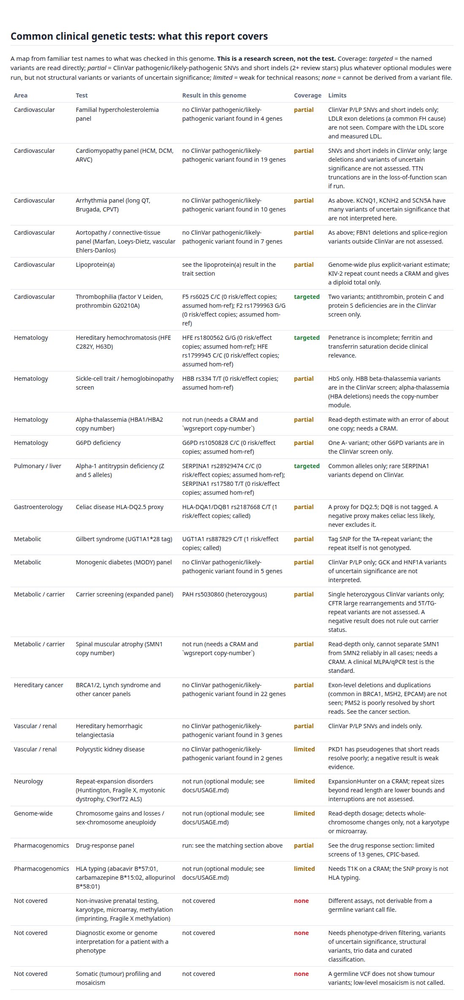
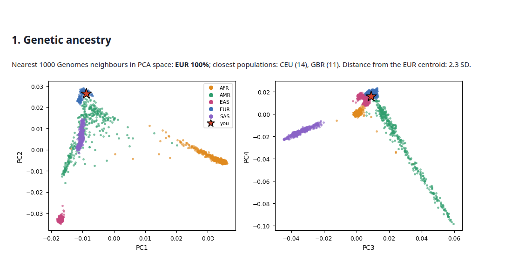
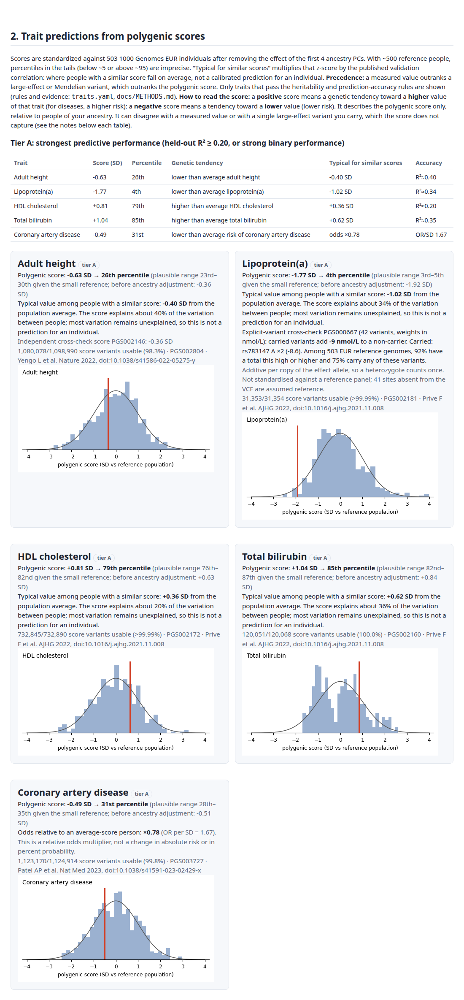
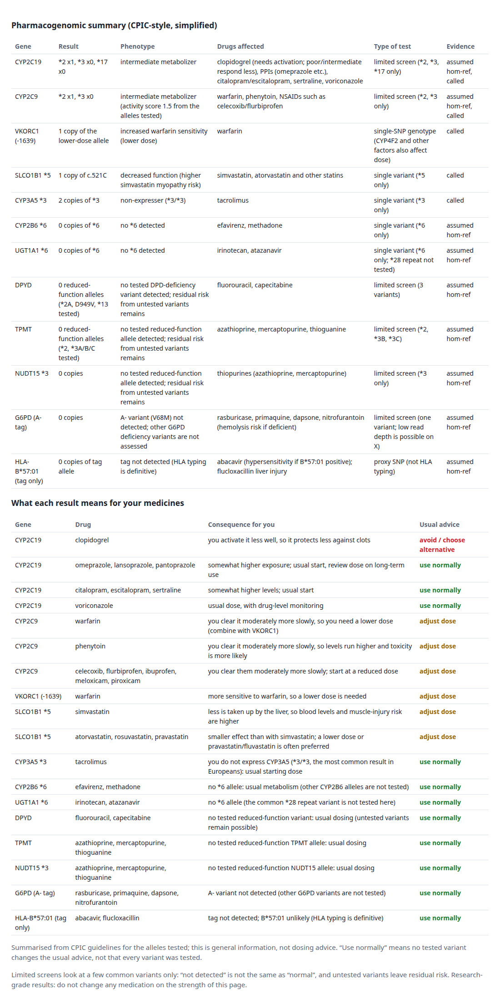
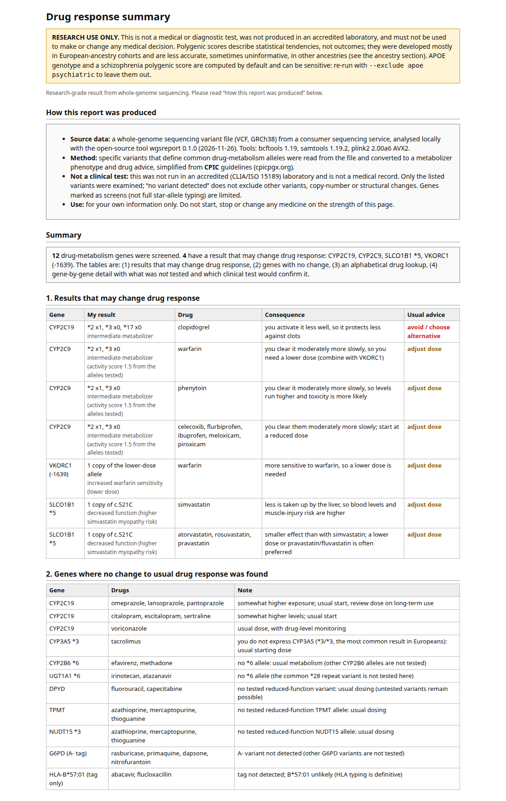

# wgs-report

> **Research use only.** Not a medical or diagnostic test; not produced in an accredited laboratory; do not use it to make or change any medical decision. Polygenic scores are statistical tendencies developed mostly in European-ancestry cohorts and are less accurate, sometimes uninformative, in other ancestries. APOE and a schizophrenia polygenic score are computed by default and can be sensitive: use `--exclude apoe psychiatric` to leave them out. Every report and `results.json` carries this notice.

Turn a personal whole-genome VCF (GRCh38, e.g. from DRAGEN or GATK) into a readable report.

A CRAM alone is not enough: the tool does not call a whole-genome VCF from it. It is also not a whole-genome annotator and does not
use gnomAD or dbSNP. Setup still needs about 70 GB of 1000 Genomes data (see [Requirements](#requirements)).

The report includes:

* **Polygenic scores** for highly heritable traits that GWAS-derived scores predict well
  (height, BMI, lipids, lipoprotein(a), bone density, urate, bilirubin, coronary artery disease,
  type 2 diabetes, atrial fibrillation, prostate cancer, a blood-test panel; schizophrenia (after `build-score`) and APOE,
  clearly flagged by evidence tier).
  Every score is standardized against 1000 Genomes after ancestry adjustment and translated into an
  expected trait value with an honest prediction interval.
* **Common clinical tests** (a table of familiar test names against what was checked, with coverage and limits).


**A drug response summary** (`medication_report.html`): what each pharmacogene result means for each drug (metabolize more or less, more or less effective, avoid, adjust dose or use normally), how it was produced, and what it cannot tell.
* **Ancestry** (PCA projection onto 1000 Genomes) so you know how far the scores can be trusted.
* **~50 curated SNPs** (pigmentation, lactase, caffeine, pharmacogenomics, thrombophilia, ...).
* **Rare diseases:** a ClinVar pathogenic/likely-pathogenic screen over all genes (exact-allele matches, at least 2 review stars
  by default, `--clinvar-min-stars 1` to widen), grouped as ACMG secondary-findings genes, homozygous, possible compound
  heterozygotes (phase unknown) and single heterozygous, plus a rare loss-of-function scan and a blood-group inference.
* **Carrier status for family planning:** ClinVar hits in recessive and X-linked genes (ClinGen curations plus the ACMG carrier
  list), including common alleles. It misses deletions and duplications, including the usual causes of spinal muscular atrophy and
  alpha-thalassemia. **It is not a laboratory carrier screen; finding nothing does not rule out carrier status.**
* **Actionable large deletions/duplications (needs a CRAM):** a read-depth screen of a short list with documented follow-up
  (22q11.2, 17q12, NF1, PMP22, 16p11.2). Not a genome-wide CNV search; not yet tested on a known deletion.
* **Optional CRAM modules:** read-level genotyping of the SNP panel, mtDNA variants, a pharmacogenomic summary,
  a rare loss-of-function scan, repeat expansions, a short actionable deletion/duplication screen (other read-depth estimates go to results.json only) and
  supervised ADMIXTURE.
* **Compare with your own lab results** (`--measured`) so the report can say where genetics and blood tests agree.

Analysis runs on your machine, and the wgs-report code does not upload your genome or genotypes. It downloads public reference
data (for example PGS Catalog weights, ClinVar and the Ensembl GFF3). Some requests carry identifiers that can show what you are
looking at: `query snp` sends an rsID to Ensembl if its coordinates are not in the bundled panel or your `--coords` file (`--offline`
prevents this), `query pgs --pgs-id` requests that score from the PGS Catalog if it is not cached (`--score-file` avoids this), and
`fetch-reference` requests sequences from EBI using the checksums in your CRAM header. This statement does not cover the network
behaviour of the optional third-party tools.

## What the report looks like
Screenshots are from a **public** genome (NA12878/HG001, Genome in a Bottle), never from a real user. The full tour is in
[docs/REPORT_GUIDE.md](docs/REPORT_GUIDE.md); how they were made is at the end of that file.

**Ancestry** tells you how far the scores can be trusted (the star is the genome; a distance above 3 SD from the nearest group triggers a warning).


**Polygenic scores**, grouped by tier of held-out accuracy, each with a percentile, the accuracy of the score and what similar-scoring people typically look like.


**Drug response**: each gene result is translated into what it does to each medicine (faster or slower metabolism, more or less effect) and the usual advice.


**Common clinical tests** (a table of familiar test names against what was checked, with coverage and limits).


**A drug response summary** (`medication_report.html`, printable). Its header says how it was produced and what it is not.


## Quick start
```bash
git clone https://github.com/cnrowley/wgs-report && cd wgs-report
conda env create -f environment.yml && conda activate wgsreport && pip install -e .
wgsreport doctor                       # checks tools, bundled data, upstream formats
wgsreport prepare --kg-dir /path/to/1000G --work-dir work      # once
wgsreport analyze --vcf my_genome.vcf.gz --work-dir work --out-dir results
```
APOE and the schizophrenia score are computed by default for users who know how to read them; pass
`--exclude apoe psychiatric` to leave them out. Intelligence and education scores are deliberately not provided.

> Not a medical device. Polygenic scores are probabilistic and less accurate outside European ancestry.

**Full guide to what you provide and every command: [docs/USAGE.md](docs/USAGE.md). How to read each section: [docs/REPORT_GUIDE.md](docs/REPORT_GUIDE.md). The drug response summary: [docs/MEDICATION_REPORT.md](docs/MEDICATION_REPORT.md).** In short: a bgzipped, indexed **GRCh38** VCF is the only required input; a CRAM + FASTA unlocks the optional modules; a GRCh37 file is refused.

## Requirements
`bcftools`, `samtools`, `plink2` (v2.0), Python >= 3.9 (`numpy pandas scipy matplotlib pyyaml`).
`conda env create -f environment.yml && conda activate wgsreport && pip install -e .`

You also need the 1000 Genomes phase-3 GRCh38 genotype VCFs (`ALL.chr{1..22}_GRCh38.genotypes.20170504.vcf.gz`
+ `.tbi`) and `integrated_call_samples_v3.20130502.ALL.panel` from
<https://ftp.1000genomes.ebi.ac.uk/vol1/ftp/release/20130502/> (the GRCh38 lift-over files are under
`supporting/GRCh38_positions/`), about 70 GB.

## Usage
```bash
# 1. one-off (no personal data; reusable for any person). ~15-30 min
wgsreport prepare --kg-dir /path/to/1000G --work-dir work

# 2. per person
wgsreport analyze --vcf my_genome.vcf.gz --work-dir work --out-dir results
#   optional: --sex male|female  --exclude apoe psychiatric (leave modules out)  --height-mean 178 --height-sd 7
open results/report.html
```
Outputs: `report.html`, `medication_report.html` (printable drug response summary; no name or ID in it), `results.json`, `snp_panel_genotypes.tsv`, `clinvar_pathogenic_hits.tsv`.

The VCF only needs to list variant sites (as DRAGEN VCFs do): sites not listed are treated as
homozygous reference. If your VCF is a gVCF-less low-coverage callset, scores will be less reliable.

## How traits are chosen
See `src/wgsreport/data/traits.yaml` (rules at the top, evidence per trait) and `docs/METHODS.md`.
Add or swap a score by editing that file; scores come from the [PGS Catalog](https://www.pgscatalog.org).

## Privacy and publishing your own copy
* The code never uploads anything. Keep your VCF/CRAM, the work directory (`--work-dir`), results, the `cram-check`
  JSON and lab spreadsheets **outside** the repository (they are also in `.gitignore`).
* Before you push a fork, run `bash scripts/check_no_personal_data.sh`. It fails on genomic file types, large files and any
  pattern you list (one regex per line, e.g. your sample ID or name) in a local, untracked `.personal_patterns` file.
  CI runs the same script.
* Reports contain health information. Treat `report.html` and `results.json` as private.

## Keeping it working
`wgsreport doctor` checks your tools, the bundled data and that PGS Catalog, ClinVar, Ensembl and the EBI reference
registry still have the formats the parsers expect (`--offline` skips the network). All URLs live in
`src/wgsreport/sources.py`. A weekly CI job runs the same checks. `CLAUDE.md` is a maintenance guide for AI
assistants and humans: tailoring recipes (add a score, a SNP, update the ACMG list) and an upstream-breakage playbook.

## Tests
`pytest` (offline). `pytest -m network` runs the upstream contract checks.

## Citations
Scores: Yengo 2022 (height), Prive 2022 (most quantitative traits), Patel 2023 (CAD), Huerta-Chagoya 2023 (T2D),
Conti 2021 (prostate). Reference panel: 1000 Genomes Project. ClinVar: Landrum et al. PGS Catalog:
Lambert et al. 2021. License: MIT (scores keep their own licenses; check the PGS Catalog entries).

## Read-level checks, pharmacogenomics and rare variants (optional)

```bash
# 1. build a primary-contig GRCh38 FASTA that matches your CRAM (public EBI registry, checksum-verified)
wgsreport fetch-reference --cram sample.cram --out ref/hg38_primary.fa
# 2. genotype the SNP panel from reads (confirms "assumed hom-ref" sites) and call mtDNA variants
wgsreport cram-check --cram sample.cram --fasta ref/hg38_primary.fa --out cram_checks.json
# 3. include everything in the report; --cyp2d6 takes a diplotype from Cyrius/Aldy/DRAGEN
wgsreport analyze ... --cram-json cram_checks.json --cyp2d6 '*1/*4' --lof-scan --fasta ref/hg38_primary.fa --kg-dir 1000G/grch38
```

`--lof-scan` annotates your VCF with `bcftools csq` and lists rare nonsense/frameshift/splice variants in ACMG
secondary-findings genes that are not in ClinVar. These are candidates for review, not diagnoses. The JSON from
`cram-check` and the report contain personal data: keep them out of version control.

## PharmCAT and HLA typing (optional external tools, not bundled)

```bash
# Quick questions about one genome (see docs/USAGE.md): SNPs, one PGS (download or file), copy number of a locus or region
wgsreport query snp rs10455872 --vcf my_genome.vcf.gz
wgsreport query pgs --vcf my_genome.vcf.gz --pgs-id PGS000667
wgsreport query copy-number --cram my.cram --fasta hg38.fa --locus SMN

# PharmCAT (Java 17+): star alleles and CPIC recommendations. Download the jar and the 'pipeline' tarball from
# https://github.com/PharmGKB/PharmCAT/releases, unpack them into one directory, `pip install colorama pandas packaging`.
wgsreport pharmcat --vcf my_genome.vcf.gz --pharmcat-dir tools/pharmcat --out pharmcat_out --cyp2d6 '*1/*4'

# T1K (C++, `make`) with the IPD-IMGT/HLA index: classical HLA typing from the CRAM (MHC and unmapped reads only)
perl t1k-build.pl -o hlaidx --download IPD-IMGT/HLA        # then rename the outputs to hlaidx_dna_seq.fa if needed
wgsreport hla-type --cram sample.cram --fasta ref/hg38_primary.fa --t1k-dir tools/T1K --index hlaidx/hlaidx_dna_seq.fa --out hla_out

wgsreport analyze ... --pharmcat-json pharmcat_out/pharmcat_summary.json --hla-json hla_out/hla.json
```
PharmCAT cannot call CYP2D6 from a VCF, so supply the diplotype from Cyrius/Aldy with `--cyp2d6`. It also treats PGx positions
missing from a variant-only VCF as unknown, which leaves most genes without a result and makes tied matches ambiguous, so the wrapper
passes `--absent-to-ref` by default (`--no-absent-to-ref` to turn that off). The report says this assumption was made.
Tied diplotypes are shown as ambiguous, not resolved by taking the first.

## More optional modules: chromosome checks, repeat expansions, Y haplogroup

```bash
# sex-chromosome dosage, whole-chromosome gains/losses, runs of homozygosity (bcftools + samtools only; ~2 min)
wgsreport genome-qc --vcf my_genome.vcf.gz --cram sample.cram --fasta ref/hg38_primary.fa --out qc.json

# ExpansionHunter (unpack a release from https://github.com/Illumina/ExpansionHunter/releases): ~30 repeat loci, thresholds from STRchive
wgsreport repeat-expansions --cram sample.cram --fasta ref/hg38_primary.fa --eh-dir tools/expansionhunter --out eh_out --sex male

# Yleaf standalone release (https://github.com/genid/Yleaf/releases); set `full hg38 genome fasta location` in its config.txt first
wgsreport y-haplogroup --cram sample.cram --fasta ref/hg38_primary.fa --yleaf tools/yleaf/yleaf --out y_out

wgsreport analyze ... --qc-json qc.json --repeats-json eh_out/repeats.json --y-haplogroup-json y_out/y_haplogroup.json
```
The rare loss-of-function scan (`--lof-scan`) covers the ACMG secondary-findings genes, the 113 ACMG carrier-screening genes, 119 ClinGen
cancer-predisposition genes (Definitive or Strong evidence; `scripts/build_cancer_genes.py` rebuilds the list) and the AF gene set.
Repeat thresholds come from STRchive (`scripts/build_repeat_thresholds.py`). Repeat sizes beyond the read length are lower bounds, and
repeat interruptions are not assessed. Chromosome dosage detects whole-chromosome changes only.
