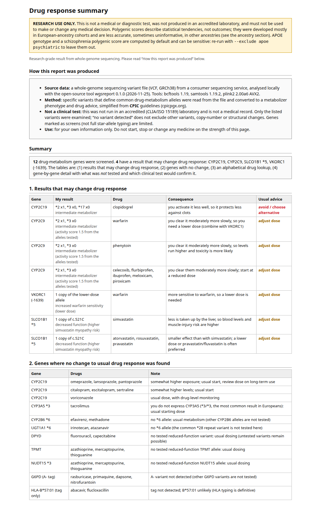
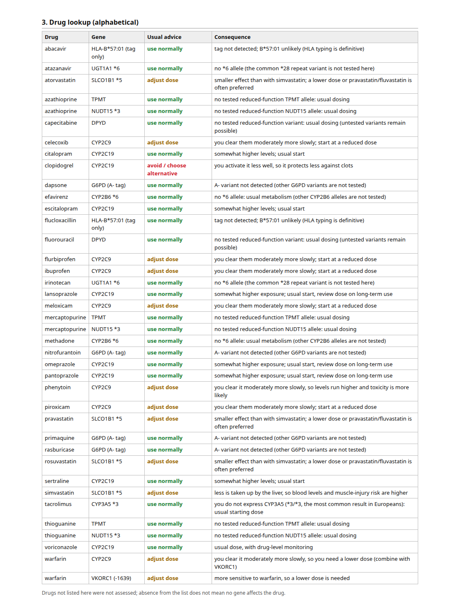

# The drug response summary (`medication_report.html`)

`wgsreport analyze` writes `medication_report.html` next to `report.html`. Open it in a browser (it prints cleanly). It has **no name or sample ID** and is for your own information. It is built from the same results as the main report and carries the same research-use disclaimer.

## What is in it
1. **How this report was produced**, at the top: a variant file from whole-genome sequencing, read locally with `wgsreport` (version and tool versions listed);
   specific variants converted to metabolizer phenotypes and drug advice simplified from CPIC guidelines; PharmCAT's version if you ran it; and a plain statement that this is
   **not** a clinical test (not run in an accredited laboratory, only listed variants examined, untested variants and structural changes not excluded).
2. **Summary**: how many genes were screened and which ones may change drug response.
3. **Results that may change drug response**: gene, result, drug, consequence for you (for example *you clear it more slowly, so levels are higher*), and the usual advice.
4. **Genes where no change was found.**
5. **Drug lookup**, alphabetical, so you can look up one medicine.

6. **Gene-by-gene detail**: the variants read and copies, the result, the guideline source, **what this screen does not cover** (for example DPYD HapB3, UGT1A1\*28, CYP2C19\*4 to \*8)
   and which clinical test would confirm it.
7. **PharmCAT calls and CPIC recommendations** (when supplied), HLA alleles with drug associations (when supplied), and notes.

## Advice categories
| Label | Meaning |
|---|---|
| use normally | no tested variant changes the standard advice |
| adjust dose | guidelines usually advise a lower (or, for tacrolimus, higher) dose |
| may be less effective | the drug may work less well, or a prodrug is activated less |
| avoid / choose alternative | guidelines advise another drug, or avoiding it |
| confirm first | needs a definitive clinical test (for example HLA typing for abacavir) before acting |

## Genes covered
CYP2D6 (needs a star-allele call), CYP2C19, CYP2C9, VKORC1, SLCO1B1, DPYD, TPMT, NUDT15, G6PD, CYP3A5, CYP2B6, UGT1A1, and an HLA-B\*57:01 proxy SNP. Each is a limited screen of the
alleles named in the detail table. Evidence levels for the underlying SNPs are in `src/wgsreport/data/snp_evidence.tsv`.

## Limits
- It is research output, not a medical record, and the wording is a simplification of CPIC; general information only. Do not start, stop or change any medicine on the strength of it.
- Single gene effects only: it does not account for interacting drugs, organ function, age or other clinical factors.
- A normal result means *no tested variant found*. Confirm anything that would change therapy with a clinical pharmacogenomic test.
- Allele frequencies differ by ancestry; variants that matter more in some populations may not be tested.

## Where the code lives
`src/wgsreport/pgx.py` (genotype to phenotype and per-drug consequences), `src/wgsreport/medication_report.py` (the handout). Add a gene by adding its SNP in
`data/snp_panel_src.yaml` (then `scripts/resolve_snp_panel.py`), an evidence level, a `consequences_*` function and an entry in `GENE_INFO`.
