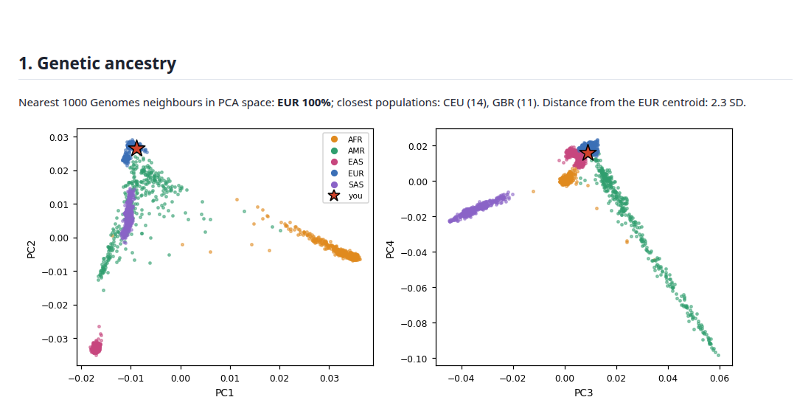
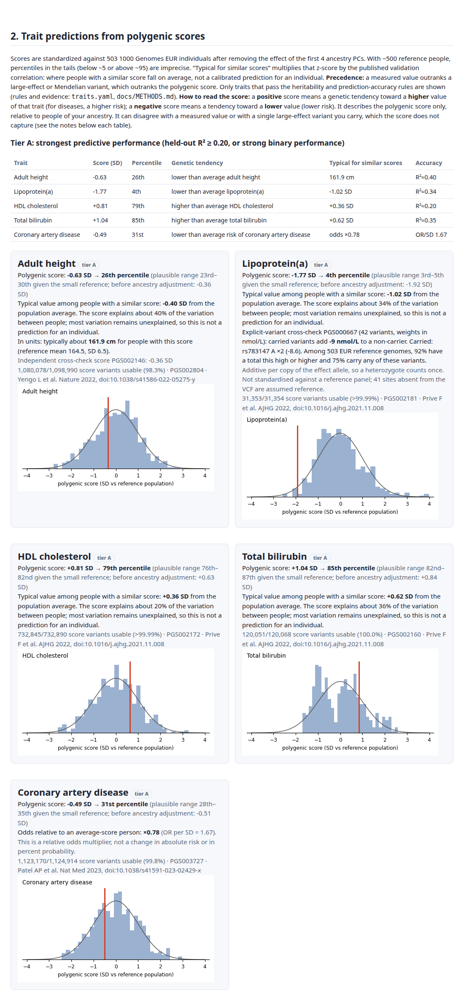
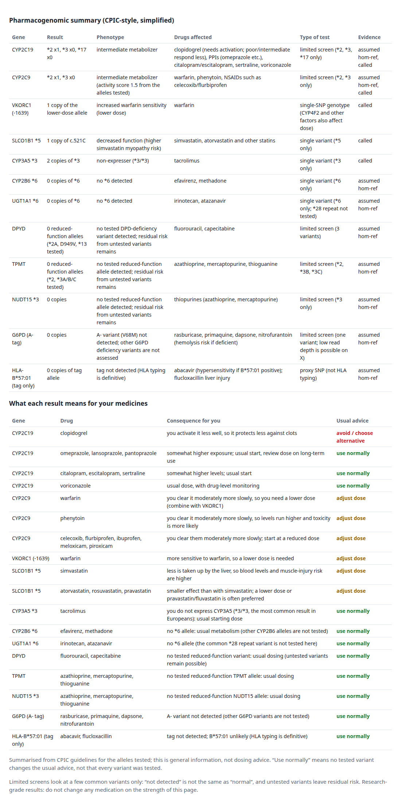
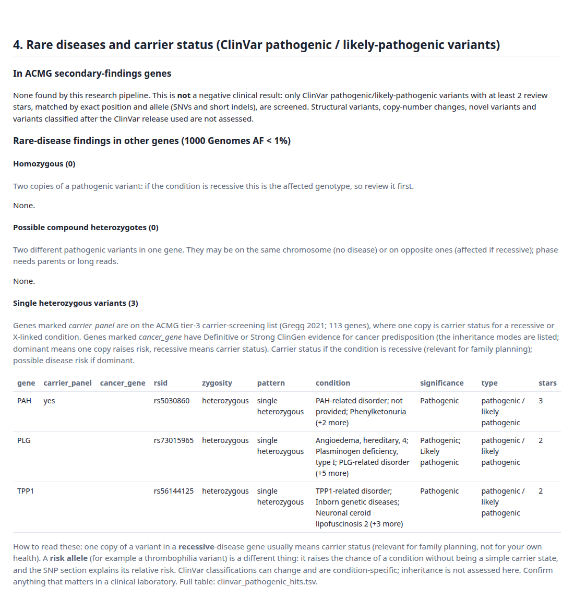
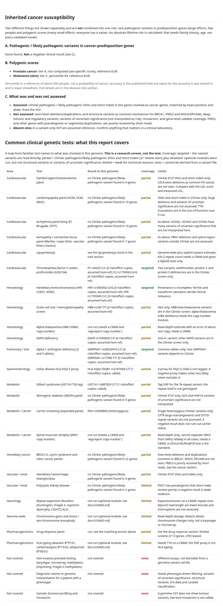
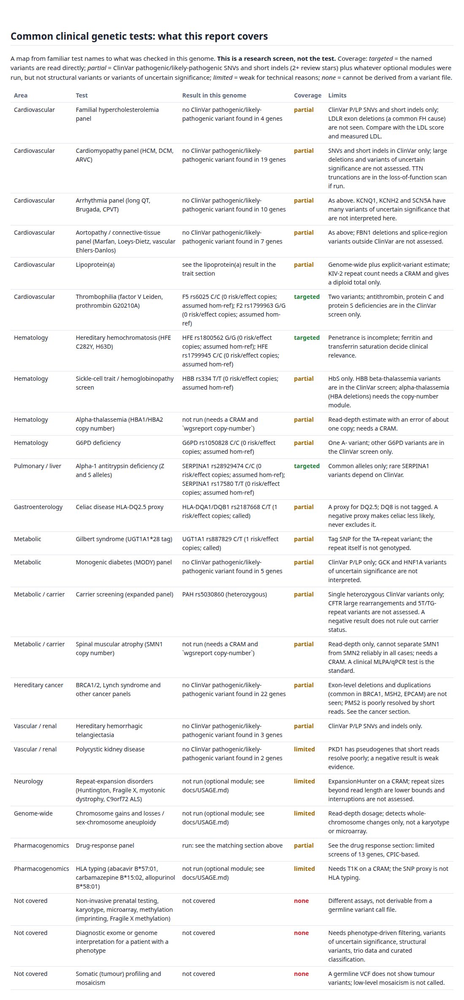

# Reading the report

All screenshots are from a public genome (NA12878/HG001, Genome in a Bottle), run through the same pipeline as anyone else's. Nothing here comes
from a real user. The report is one self-contained HTML file; keep it private, since a real one contains health information.

## 1. Genetic ancestry


The genome is projected onto the principal components of the 1000 Genomes reference. The star is you; dots are reference people coloured by continental group.
Read the text line first: the share of your nearest neighbours that belong to one group, the closest populations, and the distance from the group centre in
standard deviations. **Why it matters:** polygenic scores were mostly built and tested in European-ancestry cohorts. Above 3 SD from the nearest group (or less than 90% of
neighbours in one group) the report warns and some cross-check scores are not used. The distance is a per-axis scaled distance over six PCs, not a Mahalanobis distance.
Admixed genomes sit between clusters and get less reliable scores; the report says so rather than hiding it.

## 2. Trait predictions from polygenic scores


- **Tiers** rank *predictive performance only* (A: held-out R² at least 0.20 or strong binary performance; B: 0.09 to 0.20; C: weak, percentile only). A tier is not
  a statement about how well the biology is understood or whether the result is actionable.
- **Score (SD) and percentile**: your additive score compared with 503 European 1000 Genomes people after removing the first ancestry PCs. With a reference this small,
  tail percentiles are imprecise and the report shows a plausible range.
- **Typical for similar scores**: the z-score multiplied by the published validation correlation. It is where people with a similar score fall *on average*, not a
  prediction for you. For height it is also given in centimetres. For binary traits it is an odds multiplier, never an absolute risk.
- **Lipoprotein(a)** adds a cross-check with an explicit-weight variant set (PGS000667, in nmol/L) and lists the variants you carry. It cannot see the KIV-2 repeat count.
- **Cross-check score**: a second published score, shown when it is usable for the ancestry.

## 3. Single SNPs, drug response and blood group
Curated SNPs with notes for 0, 1 and 2 copies, each with an evidence level (A guideline-backed screen, B robust association, C interest only). Where a CRAM is supplied, the call is
confirmed from reads; without one, a site missing from a variant-only VCF is *assumed* reference and the table says so.



The pharmacogenomic table has two parts: the gene result with its type of test (a limited screen of a few alleles, a proxy SNP, or a star-allele caller) and, underneath,
**what each result means for each medicine**, with the usual advice colour-coded: green *use normally*, amber *adjust dose* or *may be less effective*, red *avoid / choose alternative* or *confirm first*.
"Use normally" means no tested variant changes the standard advice, not that every variant was tested.

## 4. Rare diseases and carrier status


ClinVar pathogenic and likely-pathogenic variants (at least 2 review stars by default; `--clinvar-min-stars 1` widens it), matched by exact position and allele.
Hits are grouped: genes on the ACMG secondary-findings list first, then homozygous, possible compound heterozygous (phase unknown), and single heterozygous
(carrier status if the disease is recessive). An empty table is **not** a negative clinical result: structural variants, repeat expansions, novel variants and
variants classified after the ClinVar release used are not assessed.

## 5. Inherited cancer susceptibility


Rare variants in predisposition genes (A) and polygenic scores (B) are shown separately and never combined. No absolute lifetime risk is computed: that needs
family history, age, sex and a validated model (see [CANCER.md](CANCER.md)). Part C lists exactly what was not assessed (exon-level deletions, deep-intronic variants,
variants of uncertain significance, mosaicism, genes poorly resolved by short reads).

## 6. Common clinical genetic tests: what this report covers


A map from familiar test names (familial hypercholesterolemia, cardiomyopathy and arrhythmia panels, hereditary cancer, carrier screening, hemochromatosis, alpha-1 antitrypsin, thalassemia,
SMA, repeat disorders, pharmacogenomics and others) to what was checked in this genome and the result. **It is a research screen, not the test.** The *Coverage* column is the honest part:
*targeted* means named variants are read directly; *partial* means ClinVar pathogenic and likely-pathogenic SNVs and short indels plus any optional modules, without structural variants or
variants of uncertain significance; *limited* means weak for technical reasons (for example PKD1 pseudogenes); *none* means it cannot be derived from a variant file (prenatal screening, karyotype, tumour profiling).
The gene lists and limits are in `src/wgsreport/data/clinical_tests.tsv`; add a row to extend it.

## Optional sections
Appear when you supply the matching input: PharmCAT star alleles and CPIC recommendations, HLA typing from reads, repeat expansions, copy number (SMN, HBA, AMY1, LPA KIV-2...),
sex-chromosome and whole-chromosome checks, mtDNA and Y haplogroups, a rare loss-of-function scan, and a comparison with your own lab results. The **Appendix** lists data-quality
checks and the software versions and score checksums used (the provenance manifest).

## Carrier status for family planning (section 4b)
Variants found in recessive or X-linked genes (including common ones), their status (one copy, two copies, unknown phase, X-linked by sex), risk alleles listed apart, repeat lengths relevant to children, a table of what cannot be assessed, and a collapsible gene-by-gene table for the ACMG carrier list. Compare gene by gene with a partner's results. "Nothing found" never rules out carrier status.

## Actionable large deletions and duplications (section 7b, needs a CRAM)
Six changes at five regions, each with its documented follow-up and how strong that guidance is. It is not a genome-wide CNV search. A flag needs confirmation by an independent assay. See [METHODS.md](METHODS.md) and [VALIDATION.md](VALIDATION.md).

## The drug response summary
See [MEDICATION_REPORT.md](MEDICATION_REPORT.md).

## How these screenshots were made
```bash
# one public genome (GIAB HG001, GRCh38 benchmark VCF), analysed like anyone else's
wgsreport analyze --vcf HG001_GRCh38_1_22_v4.2.1_benchmark.vcf.gz --work-dir work --out-dir demo --sex female
# needs google-chrome or chromium, and Pillow
python scripts/make_screenshots.py demo docs/img
```
Never generate screenshots from your own genome for the repository (`scripts/check_no_personal_data.sh` does not read images).
